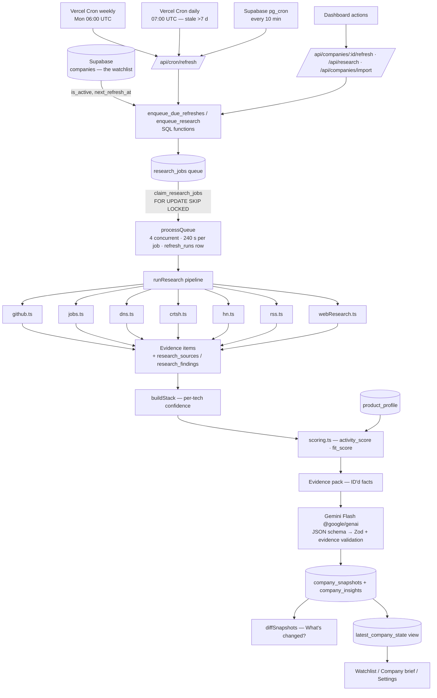

# Components Map — Tech Stack Scout

*Every component, what it is responsible for, its inputs, outputs and dependencies. Paths are relative to the repo root.*

## Data flow

## UI pages

| Component | Responsibility | Inputs | Outputs | Depends on |
|---|---|---|---|---|
| Watchlist `src/app/page.tsx` + `WatchlistTable.tsx` | Sortable/filterable account table, last run + next scheduled run, add/remove/refresh/export | `latest_company_state`, `refresh_runs` | Navigation, API actions | `lib/views.ts`, `Sparkline.tsx`, `AddCompaniesDialog.tsx`, `ResearchActions.tsx` |
| Company brief `src/app/company/[id]/page.tsx` | Pre-call brief: summary, outreach card, talking points, scores, charts, infra by category with evidence, hiring, signals, DNS/CT, history, source status | Latest `company_snapshots` + `company_insights`, snapshot history | Copyable outreach line, source edits, refresh | `Charts.tsx` (Recharts), `CompanyDetailsForm.tsx`, `lib/data.ts` |
| Settings `src/app/settings/page.tsx` | Product profile editor, refresh run history, "Refresh all stale now", preferences, removed companies, API status | `product_profile`, `app_settings`, `refresh_runs`, `/api/health` | Profile and settings updates | `SettingsForm.tsx`, `lib/health.ts` |
| Research activity `src/app/activity/page.tsx` | Job-level status, attempts, durations, explained errors, retry | `research_jobs`, `research_batches` | Retry actions | `ResearchActions.tsx` |
| Login `src/app/login/page.tsx` + `src/middleware.ts` | Password gate (`APP_PASSWORD`, httpOnly HMAC cookie) | Password | Session cookie | `lib/auth.ts` |
| Live progress `LiveProgress.tsx` | Polls the queue and shows "x of N researched", refreshing the page on change | `/api/jobs/progress` | — | — |

## API routes

| Route | Responsibility | Inputs | Outputs |
|---|---|---|---|
| `GET /api/cron/refresh` | Scheduler entry: queue never-researched and due companies, then drain the queue in the background | `Authorization: Bearer CRON_SECRET`, `?source`, `?mode=drain` | `{queuedNow, runnableJobs}` |
| `POST /api/companies` · `/import` | Add one company / bulk CSV (re-validated server-side) and queue research | Company fields / rows | Created rows, batch |
| `PATCH / DELETE /api/companies/[id]` | Edit sources, deactivate/reactivate, permanently delete | Patch body | Company |
| `POST /api/companies/[id]/refresh` | "Refresh now" for one company | — | Queue result |
| `POST /api/companies/detect` | Auto-detect GitHub org, job board and RSS feed for the Add dialog | name, domain | Suggestions |
| `POST /api/research` | Research all / stale / needs attention / specific companies | scope or ids | Queue result |
| `GET /api/jobs/progress` · `POST /api/jobs/[id]/retry` | Live progress; retry failed job | — | Counts / ok |
| `GET/PUT /api/product-profile` · `/api/settings` | Product profile; preferences | JSON | Saved row |
| `GET /api/export` | CSV of the latest state of every company | — | CSV (formula-escaped) |
| `GET /api/health` | Connection status, no secrets | — | Checks |
| `POST /api/auth/login` · `/logout` | Session cookie | Password | Redirect |

## Collectors (`src/lib/collectors/`) — run in parallel; a failing source never fails the company

| Collector | Responsibility | External API | Output |
|---|---|---|---|
| `github.ts` | Identify org (provided → verified via website/brand → unconfirmed name match); GraphQL repos + languages (≤300); 52-week commit stats (202 retry), contributors, releases; trees, manifests, workflows, Terraform providers, Serverless provider; microservices heuristic | GitHub GraphQL + REST, raw.githubusercontent.com | languages, recent_languages, activity, code evidence |
| `jobs.ts` | Stored or auto-discovered board (saved back); engineering filter; per-tech posting counts; 5 relevant roles | Greenhouse, Lever, Ashby | hiring, job evidence |
| `dns.ts` | Hosting/CDN from CNAME/NS, email from MX, SaaS from TXT verification records and SPF | dns.google DoH | dns, DNS evidence |
| `crtsh.ts` | Deduplicated subdomains and tooling flags (25 s timeout) | crt.sh | subdomains, subdomain evidence |
| `hn.ts` | Engineering stories (domain match or name + keyword), top 5 by points | HN Algolia | hn_stories, article evidence |
| `rss.ts` | Feed discovery (saved back), 5 latest posts, technical flag | Company site (RSS/Atom via rss-parser) | blog_posts, article evidence |
| `webResearch.ts` | Grounded findings: talks, migrations, announcements — URLs from grounding supports only | Gemini + Google Search | web_research, weak evidence |

## Core modules

| Component | Responsibility | Inputs | Outputs |
|---|---|---|---|
| `src/lib/techDictionary.ts` | About 185 technologies: category, aliases, text/path/dependency patterns, Terraform/Serverless parsers | Text, paths, deps | Matches (shared by every collector and the UI) |
| `src/lib/research/analysis.ts` | Aggregate evidence → stack (F-IDs, per-tech confidence); overall research confidence; snapshot diff | Evidence, previous snapshot | `StackItem[]`, `ChangeItem[]` |
| `src/lib/scoring.ts` | Deterministic activity_score, fit_score (with breakdowns), per-technology confidence | Activity, hiring, stack, languages, product profile | Scores + components |
| `src/lib/ai/report.ts` | Evidence pack, prompt, response schema, Zod + evidence validation, citation stripping | Snapshot data, product profile | Validated insight |
| `src/lib/ai/gemini.ts` | `@google/genai` client: JSON output, Google Search grounding, retry/backoff, Flash fallback, daily-quota pause | Prompt | Text + usage + grounding metadata |
| `src/lib/research/pipeline.ts` | The single research pipeline (collect → store → score → AI → snapshot + insight + diff) | Job | Snapshot + insight rows |
| `src/lib/jobs/queue.ts` | Claim, concurrency, timeouts, retries, rate-limit pause, `refresh_runs` bookkeeping | Queue | Run results |
| `src/lib/companyInput.ts` | Zod validation/normalisation of company input, CSV import/export, duplicate detection | Raw input / CSV | Clean rows |
| `src/lib/env.ts` | Environment validation (never echoes values) | `process.env` | Typed config |

## Supabase

| Object | Responsibility |
|---|---|
| `companies` | The watchlist: name, domain (unique), github_org, job_board_provider/slug, blog_rss_url, notes, is_active, research status, next_refresh_at |
| `company_snapshots` | One row per refresh: languages, recent_languages, infra_signals, activity, hiring, dns, subdomains, hn_stories, blog_posts, web_research, activity_score, fit_score, breakdowns, source_status, evidence pack, changes |
| `company_insights` | Gemini output per snapshot: summary, outreach_line, outreach_rationale, talking_points, model |
| `product_profile` | Single row; drives fit scores and outreach |
| `refresh_runs` | One row per processing run: trigger, source, status, processed, errors |
| `research_jobs` / `research_batches` | Idempotent job queue (one active job per company) and bulk progress |
| `research_sources` / `research_findings` | Every collected source URL and per-technology finding with first/last observed |
| `latest_company_state` (view) | Active company + latest snapshot + insight |
| `enqueue_research`, `enqueue_due_refreshes`, `claim_research_jobs` | Queue functions (service role only) |
| pg_cron `tech-stack-scout-refresh` | Calls `/api/cron/refresh` every 10 min (URL + secret in Vault) |

## Cron jobs

| Schedule | Caller | Purpose |
|---|---|---|
| `0 6 * * 1` | Vercel Cron | Weekly refresh (the freshness guarantee) |
| `0 7 * * *` | Vercel Cron | Daily drain of anything older than 7 days |
| `*/10 * * * *` | Supabase pg_cron | New rows added in Supabase, retries, chained batches |

## External APIs

GitHub GraphQL/REST · Greenhouse/Lever/Ashby job boards · Google Public DNS (DoH) · crt.sh · Hacker News Algolia · company RSS feeds · Gemini Flash (`@google/genai`, incl. Google Search grounding).
