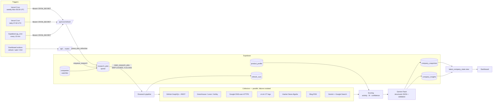

# Tech Stack Scout

AI-powered tech-stack intelligence for a B2B sales rep (MESA C4 · Problem Statement 5).

Nikhil sells a developer-productivity tool to engineering teams. Before every call he needs to know how the target company builds software: its languages, its cloud and infrastructure tooling, and how actively it ships. Tech Stack Scout keeps his **Supabase watchlist** current automatically. Every week it collects **live public evidence** from 7 sources, scores activity and product fit **in code**, and asks **Gemini Flash** for a two-paragraph engineering summary, three talking points and a specific, non-generic outreach opening line. Every claim links back to its source.

**Live app:** https://tech-stack-scout-kappa.vercel.app · **Demo password:** `scout-demo-2026`
**Repo:** https://github.com/hrishitavijaywargi/tech-stack-scout · **Components Map:** [COMPONENTS_MAP.md](COMPONENTS_MAP.md)

---

## What it does

| Page | What Nikhil sees |
|---|---|
| **Watchlist** `/` | Every active account: top 3 languages (coloured chips), primary cloud, activity score with a 52-week commit sparkline, fit score, open engineering roles with a trend arrow, and last refreshed (with a stale warning after 7 days). Sort and filter by fit, activity, cloud or language, or search. Add a company (with **Auto-detect** of GitHub org, job board and RSS), upload a CSV, remove (deactivate), refresh now, export CSV. The header shows the last refresh run and the next scheduled run. |
| **Company brief** `/company/[id]` | The Gemini summary (two paragraphs) with observation vs hypothesis labels, plus the outreach line in a highlighted card with a copy button, its rationale and 3 talking points with evidence links. Also: fit and activity score breakdowns, a language donut (recent 180 days / all-time toggle), the 52-week commit chart, infrastructure grouped by category with confidence badges and expandable evidence, hiring (open roles, a tech-mention bar chart, sample roles), a signals feed (blog, Hacker News, grounded web research), DNS and certificate findings, snapshot history and "What's changed?", and a data-source status panel. |
| **Settings** `/settings` | Edit the **product profile** (which drives fit scores and outreach), refresh run history with errors, "Refresh all stale now", research preferences, removed companies (restore), and live API connection checks. |
| **Research activity** `/activity` | Per-company jobs: attempts, durations, explained errors, retry. |

## Architecture



The same pipeline (`src/lib/research/pipeline.ts`) serves manual, bulk and scheduled refreshes. Jobs are claimed atomically in Postgres (one active job per company), run 4 at a time, and each is capped at 240 s so it always finishes inside Vercel's 300 s function limit. When the budget runs low the processor stops starting jobs and chains another invocation. Failures retry with exponential backoff. Rate limits (GitHub, or Gemini's daily quota) pause the whole queue until the reset instead of failing jobs.

## Data sources

| # | Source | Module | What it contributes |
|---|---|---|---|
| 1 | **GitHub GraphQL + REST** (token) | `collectors/github.ts` | GraphQL lists up to 300 public non-fork repos **with languages** in 3 calls. All-time and **recent (180 d)** language mix. REST adds the 52-week `stats/commit_activity` (retries 202s), contributors, releases (count in 90 d), recursive file trees (Docker, k8s, Helm, Terraform, CI configs, proto), dependency manifests (Kafka, gRPC, Redis, Postgres, OTel, Datadog, Sentry, Prisma…), CI workflow contents (aws-actions, google-github-actions, azure/login, docker/build-push-action), **Terraform providers** (`aws`/`google`/`azurerm`/`cloudflare`) and **Serverless** `provider.name`. Microservices heuristic: Dockerfiles in several repos + Kubernetes/Helm + protobuf/gRPC. |
| 2 | **Greenhouse / Lever / Ashby** public job APIs | `collectors/jobs.ts` | Uses the stored `job_board_provider`/`job_board_slug`, or auto-discovers a board (accepted only if the board or postings name the company) and **saves it back**. Separates engineering roles, counts how many postings mention each technology, picks the 5 most relevant roles, and tracks hiring velocity against the previous snapshot. |
| 3 | **Google Public DNS (DoH)** | `collectors/dns.ts` | CNAME/NS → hosting and CDN (AWS, GCP, Azure, Vercel, Netlify, Heroku, Fastly, Akamai, Cloudflare). MX → Google Workspace / Microsoft 365. TXT → about 45 SaaS verification prefixes (Atlassian, Docker, Stripe, Okta, Slack…). SPF includes → SendGrid, Mailgun, SES… |
| 4 | **crt.sh** Certificate Transparency | `collectors/crtsh.ts` | Unexpired subdomains, deduplicated with wildcards dropped. Flags tooling (grafana, jenkins, argocd, k8s, vault, sentry, jira, airflow, staging…). 25 s timeout, background only. |
| 5 | **Hacker News** (Algolia API) | `collectors/hn.ts` | Last-365-day stories on the company's domain, or naming it with an engineering keyword. Top 5 by points. |
| 6 | **Engineering blog RSS** (`rss-parser`) | `collectors/rss.ts` | Uses `blog_rss_url` or auto-discovers via `<link rel="alternate">` and common feed paths (and **saves it back**). Takes the 5 latest posts and flags technical ones. |
| 7 | **Gemini Flash + Google Search grounding** | `collectors/webResearch.ts` | Talks, engineering posts, migrations and announcements from the last 12 months. Each finding's URL comes from the API's `groundingSupports` → `groundingChunks`, not from model text. Ungrounded lines are dropped. Treated as weak, supplemental evidence. |

All detection uses one dictionary, [`src/lib/techDictionary.ts`](src/lib/techDictionary.ts): about 185 technologies, each with a category, aliases (golang → Go, GCP → Google Cloud, k8s → Kubernetes) and path/dependency/text patterns. It's shared by repository scanning, job parsing, DNS mapping and the UI.

## Scoring (deterministic — computed in code, not by the LLM)

**activity_score (0–100)** — `src/lib/scoring.ts`. Each input is log-scaled, `log(1+x)/log(1+full)`, capped at 1:

| Input | Weight | Full marks at |
|---|---|---|
| Commits in last 90 days (52-week stats of the 10 most recently pushed repos) | 30 | 1,500 |
| Repos pushed in last 30 days | 15 | 25 |
| Repos pushed in last 90 days | 10 | 50 |
| Distinct contributors (top 5 repos, bots excluded) | 15 | 100 |
| Releases in last 90 days | 15 | 20 |
| Open engineering roles | 15 | 50 |

Very active orgs land at 80–100 (Stripe scores 94) and dormant ones at 0–20.

**fit_score (0–100)** compares against the `product_profile`:

- **Target languages ×40:** the share of *recently active* code (180 d; else all-time) in target languages, with full marks at ≥50%. With no public code, target languages named in job postings give up to 20 points.
- **Target clouds ×30:** the best detected target cloud scores 30 at high confidence, 24 at medium, 12 at low.
- **Target signals ×30:** each detected target signal (Microservices, Kubernetes, Monorepo…) adds 1 at high confidence, 0.8 at medium, 0.4 at low. Full marks at 3.

**Confidence per technology:** **high** = found in 2+ independent source families (code, jobs, DNS, certificate logs, articles, web research). **medium** = one strong source (public code/config, or 3+ job postings). **low** = a weak signal only (one DNS record, a couple of job mentions, an article, a subdomain).

**Language mix:** shares are by code bytes, but each repo's weight is capped at 2× the median repo size, so a vendored codebase (e.g. Discord's `postgres_bazel`) can't make the org look like a C shop. Raw byte totals are kept.

**Research confidence (High/Medium/Low):** GitHub identification + code coverage + source diversity + recency (25 points each). Unconfirmed GitHub matches are capped at Medium.

## Gemini insights

Gemini never sees raw API dumps. `src/lib/ai/report.ts` builds a compact **evidence pack** of ID'd facts:
- **F*n*:** technologies with confidence
- **M*n*:** activity and its trend versus the previous snapshot
- **R*n*:** releases
- **H1 / J*n*:** hiring, with trend and top tech mentions, plus sample roles
- **D*n*:** DNS
- **S1:** subdomain tooling
- **A*n*:** blog and Hacker News items
- **W*n*:** grounded web findings

The pack also carries the scores and the product profile. The call goes through the official **`@google/genai` SDK** with `responseMimeType: application/json` and a `responseSchema`, and returns:
- a summary of two paragraphs
- an outreach line (one sentence, under 35 words)
- the outreach rationale
- 3 talking points with evidence IDs
- observation/hypothesis statements
- limitations

The output is validated with Zod **and against the evidence**: every cited ID must exist, it can't name technologies absent from the evidence, and brackets/placeholders, banned phrases ("I hope this finds you well", "I noticed your company is growing"…) and "you have a problem" claims are rejected. The line must name a concrete cited detail. On failure it retries with the errors as corrective feedback (up to 3 attempts). With no evidence at all, a deterministic "insufficient evidence" brief is written instead. The model name is stored.

Models are configurable: `GEMINI_MODEL` (default `gemini-3.6-flash`) and `GEMINI_FALLBACK_MODEL` (`gemini-3.8-flash`), both stable Flash models. The fallback covers 429/5xx errors, and web research starts on the fallback so the two calls per company use separate free-tier quotas.

## Setup

1. **Supabase.** Run `supabase/migrations/*.sql` in order (SQL editor or `supabase db push`), then `supabase/seed.sql` (8 companies, verified with `npx tsx scripts/verify-seed.ts`). Tables: `companies`, `company_snapshots`, `company_insights`, `product_profile`, `refresh_runs`, `research_jobs`, `research_batches`, `research_sources`, `research_findings`, `app_settings`, `http_cache`; view `latest_company_state`. RLS is enabled on every table with no anon/authenticated policies, so the browser can't read the database. All reads and writes happen server-side with the service-role key.
2. **Environment** (`.env.example` → `.env.local`, and the same keys in Vercel):

   | Variable | Notes |
   |---|---|
   | `NEXT_PUBLIC_SUPABASE_URL` | Project URL (`SUPABASE_URL` also accepted) |
   | `NEXT_PUBLIC_SUPABASE_ANON_KEY` | Publishable key; not used by the browser today |
   | `SUPABASE_SERVICE_ROLE_KEY` | Secret key, **server only** |
   | `GITHUB_TOKEN` | Public read access; needed for GraphQL and 5,000 requests/h |
   | `GEMINI_API_KEY` | https://aistudio.google.com/apikey |
   | `GEMINI_MODEL` / `GEMINI_FALLBACK_MODEL` | Default `gemini-3.6-flash` / `gemini-3.8-flash` |
   | `WEB_RESEARCH_ENABLED` | `true` (adds one Gemini call per company) |
   | `CRON_SECRET` | Protects `/api/cron/refresh` |
   | `APP_PASSWORD` | Password gate (httpOnly cookie). Demo: `scout-demo-2026` |
3. **Run locally:** `npm install && npm run dev` → http://localhost:3100
4. **Deploy:** import the GitHub repo in Vercel and add the env vars. `vercel.json` sets region `bom1`, `maxDuration: 300`, and two crons:
   - `/api/cron/refresh?source=vercel-weekly` at `0 6 * * 1` (weekly, Monday 06:00 UTC)
   - `/api/cron/refresh?source=vercel-daily` at `0 7 * * *` (daily: anything older than 7 days, so the queue always drains)
5. **Supabase pg_cron (recommended):** edit and run `supabase/scheduler.sql`. It calls the same endpoint every 10 minutes, which picks up rows added directly in Supabase, retries, and chained batches. Verify with `select status_code, content from net._http_response order by id desc limit 5;`.
6. **Manual trigger:** `curl -H "Authorization: Bearer $CRON_SECRET" https://<app>/api/cron/refresh`

## Adding and removing companies without code

- **In the app:** use *Add company* (name + domain, with optional auto-detected sources), *Upload CSV*, or *Remove* (sets `is_active = false`). Restore from Settings.
- **In Supabase (Table Editor or SQL):**
  ```sql
  -- add: picked up and researched within ~10 minutes (pg_cron) or at the next daily cron
  insert into companies (name, domain, github_org, job_board_provider, job_board_slug)
  values ('Linear', 'linear.app', 'linear', 'ashby', 'linear');

  -- remove from the watchlist (keeps history)
  update companies set is_active = false where domain = 'linear.app';
  -- …or delete it and all its snapshots
  delete from companies where domain = 'linear.app';
  ```
  Only `name` and `domain` are required. Every other field is optional and is auto-discovered and saved back when possible.

## Testing

```bash
npm test             # 50 unit/integration tests: dictionary, DNS mapping, TXT/SPF parsing, crt.sh, HN, RSS,
                     # job tech extraction, GitHub collector (mocked API), scoring, confidence, change tracking,
                     # Gemini quota parsing, AI-output validation, CSV import/export
npm run typecheck
npm run build && npm run check:bundle      # fails if any secret appears in client JS
npx tsx --conditions=react-server --env-file=.env.local scripts/smoke-collectors.ts Stripe stripe.com stripe greenhouse stripe
npx tsx --conditions=react-server --env-file=.env.local scripts/smoke-web.ts Stripe stripe.com
npx tsx scripts/verify-seed.ts             # checks every seed GitHub org + job board returns data
```

## Known limitations

- **Public data only.** Private repos and internal systems are invisible, and every brief says so. Code-based findings describe open-source work, which can differ from the product stack.
- **Rate limits.**
  - **GitHub:** 5,000 requests/h with a token, about 40–60 per company, with ETag caching. Code Search (10 requests/min) isn't used; recursive tree listings give the same file-level signals without that limit.
  - **Gemini free tier:** about 20 requests/day *per model*. With 2 calls per company, a full first refresh of 20+ companies can span two days. Jobs pause and resume automatically. Enable billing on the AI Studio project to remove this.
- **crt.sh** is often slow or down. It has a 25 s timeout, and a failure only marks that source as *error*.
- **Job boards:** only Greenhouse, Lever and Ashby have public APIs. Workday, iCIMS and in-house careers sites aren't read.
- **Blogs:** only RSS/Atom. Some sites block automated requests (reported as such).
- **Web research** is supplemental and weak evidence. Citation links are Google grounding redirect URLs.
- **GitHub identification:** a name-only match is labelled *unconfirmed*, which caps confidence and flags the outreach line "verify before sending".
- **Single user:** one password gate, no per-user accounts.
